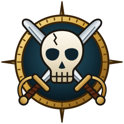

# ElGus Recomps

  
  
  

🎮 **Xbox 360 classics, running natively on your PC.** Each game here is *recompiled*: its original code is
translated and rebuilt as a Windows program, so it runs directly on your computer, with no emulator to set up,
sharper graphics, wide screens and higher frame rates.

> [!IMPORTANT]
> 💿 **You need your own original copy of each game.** These projects do not include any game files, and never
> will. You install each game from an image (ISO) of your own disc. Please do not ask for game files, and do not
> share them or links to them.
>
> These projects are not affiliated with or endorsed by the games' publishers or developers.

## 🕹️ Games

| | Game | Status | Get it |
|:---:|---|---|---|
|  | **[Kameo: Elements of Power](https://github.com/ElGuslml/KameoRecomp)** Xbox 360, 2005 · Rare An elf princess who turns into elemental warriors to rescue her family. |   | [⬇️ Download](https://github.com/ElGuslml/KameoRecomp/releases/latest) [📖 Project page](https://github.com/ElGuslml/KameoRecomp) |
|  | **[Pirates of the Caribbean: At World's End](https://github.com/ElGuslml/PiratesAtWorldsEndRecomp)** Xbox 360, 2007 · Eurocom Captain Jack Sparrow's adventure through the second and third films. |   | [⬇️ Download](https://github.com/ElGuslml/PiratesAtWorldsEndRecomp/releases/latest) [📖 Project page](https://github.com/ElGuslml/PiratesAtWorldsEndRecomp) |
| 🎯 | **Tom Clancy's Ghost Recon Advanced Warfighter** Xbox 360, 2006 | 🔜 **Coming soon** | Follow the [Discord](https://discord.gg/XQtM5TmNs8) or [X](https://x.com/ElGuslml) for news |
| 🎸 | **Guitar Hero: Metallica** Xbox 360, 2009 | 🔥 **Very close to release** | Follow the [Discord](https://discord.gg/XQtM5TmNs8) or [X](https://x.com/ElGuslml) for news |
| 🎸 | **Guitar Hero: Van Halen** Xbox 360, 2009 | 🔥 **Very close to release** | Follow the [Discord](https://discord.gg/XQtM5TmNs8) or [X](https://x.com/ElGuslml) for news |
| 🎸 | **Guitar Hero: Aerosmith** Xbox 360, 2008 | 🔥 **Very close to release** | Follow the [Discord](https://discord.gg/XQtM5TmNs8) or [X](https://x.com/ElGuslml) for news |

More games are on the way. 🚀

## ✨ What every game gets

- 🖥️ **Native graphics:** drawn by your graphics card at your screen's resolution, with smooth edges and sharper
  textures.
- ⚡ **Higher frame rates:** 60 FPS at the original game speed, and more where the game allows it.
- 📺 **Wide and ultrawide screens:** more of the world to the sides, with menus and videos kept in shape.
- 🏆 **Achievements:** unlock notifications and the full list, as on the console.
- 🧭 **A launcher for each game:** it installs the game from your ISO, lets you choose your settings with the mouse,
  keyboard or a controller, and keeps the game up to date.
- 🎮 **Your controller:** Xbox, PlayStation and other controllers, with buttons you can change.

## 🚀 Getting started

1. Open the game's **Download** link above and get **the installer** (`...-setup.exe`) or **the zip**.
2. Run the game's **launcher**. The first time, it asks for the ISO of your disc, checks it and installs the game.
3. Pick your settings and press **PLAY**. That's it! 🎉

**You need:** Windows 10 or 11 (64-bit), a graphics card with up-to-date drivers (Vulkan), and the
[Microsoft Visual C++ Redistributable](https://aka.ms/vs/17/release/vc_redist.x64.exe), which most PCs already have.

## ❓ Questions

**What is a "recompilation"?**
Instead of emulating the Xbox 360 while the game runs, the game's code is translated ahead of time into a
Windows program. That is why it runs fast and can be improved: higher frame rates, wide screens, new options.

**Do I need an emulator?**
No. Each game is a regular Windows program with its own launcher.

**Where do I get the game files?**
From your own copy of the game: an ISO image of your own Xbox 360 disc. We cannot help you get one.

**Windows says "Windows protected your PC".**
The programs are not signed by a company, so Windows SmartScreen may warn you the first time. Click
**More info**, then **Run anyway**.

**Something looks wrong.**
Each launcher has two renderers. The default one draws the game natively; the other, Xenos, emulates the
Xbox 360's graphics instead. Try the other one in the launcher's **Graphics** page, and tell us whether the
problem happens there too.

**I found a bug.**
Tell us on [Discord](https://discord.gg/XQtM5TmNs8) or open an issue on the game's project page, with where it
happened, a screenshot if you can, and the latest file in the `logs` folder next to the game.

**Linux or Steam Deck?**
Windows only for now.

## ❤️ Support

If you enjoy these games, you can support the work on [Ko-fi](https://ko-fi.com/elguslml) ☕. For news and
previews of the next games, follow [@ElGuslml on X](https://x.com/ElGuslml) and join the
[Discord](https://discord.gg/XQtM5TmNs8).

## 🧰 Built with

- [ReXGlue SDK](https://github.com/rexglue/rexglue-sdk), the recompiler and the Xbox 360 runtime, derived from
  [Xenia](https://xenia.jp).
- [NativeXRenderer](https://github.com/ElGuslml/NativeXRenderer), the native renderer the games are drawn with.

## 🤖 A note about AI

These projects are developed with the help of AI ([Claude](https://claude.ai), by Anthropic). I know it's a touchy
subject for many people, so I want to be open about it and explain how the work is done:

- 🎮 **The game is still the original game.** Its code is translated by the ReXGlue recompiler, not written by an
  AI, so it plays as it did on the Xbox 360.
- 🧪 **Every change is tested by hand.** I play each fix and improvement myself before it is released, and check it
  against how the game behaves on the console: its speed, its graphics, its sound and how it feels to play.
- ⚡ **Performance is measured, not guessed.** CPU use, frame times and GPU time are measured on real hardware
  before and after each change, so that every game runs smoothly and doesn't waste your computer's resources.
- 🙌 **Claude helps with the research and the code;** the decisions, the testing and the care for every game are mine.

If something doesn't run as well as it should, it's a bug like any other: tell us on
[Discord](https://discord.gg/XQtM5TmNs8) or open an issue, and it will get fixed. Thanks for giving these games a
try! 💜

Made by Gustavo Garcia ([@ElGuslml](https://github.com/ElGuslml)) with the help of Claude (Anthropic).
